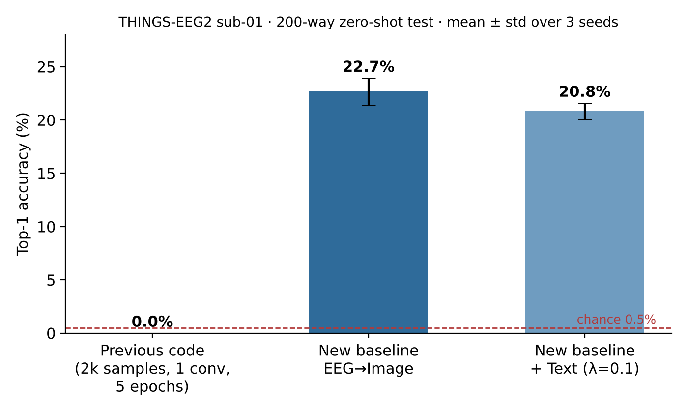
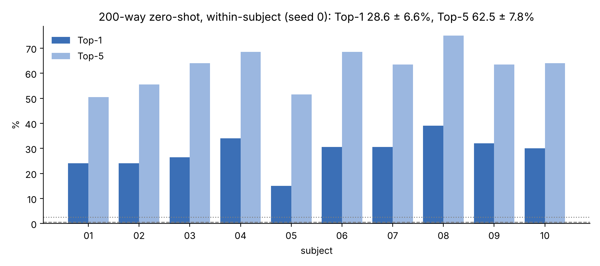
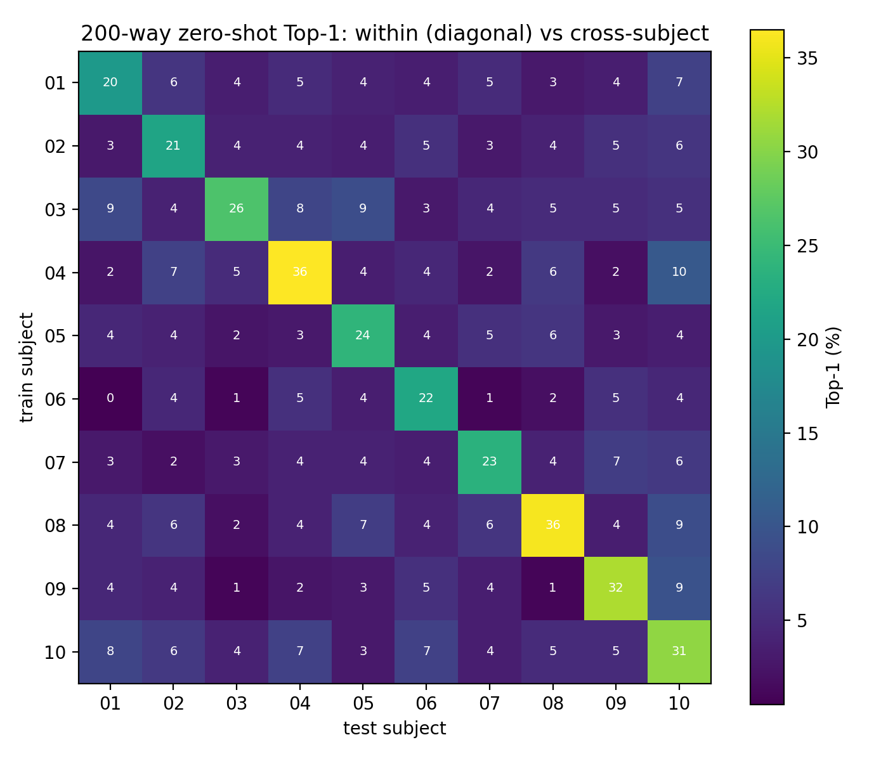
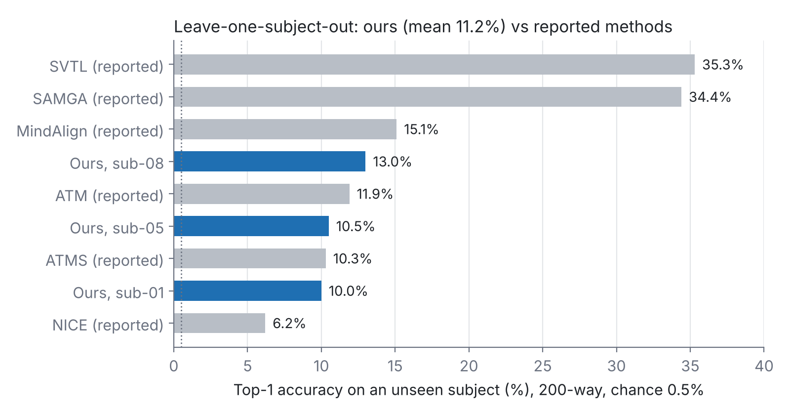
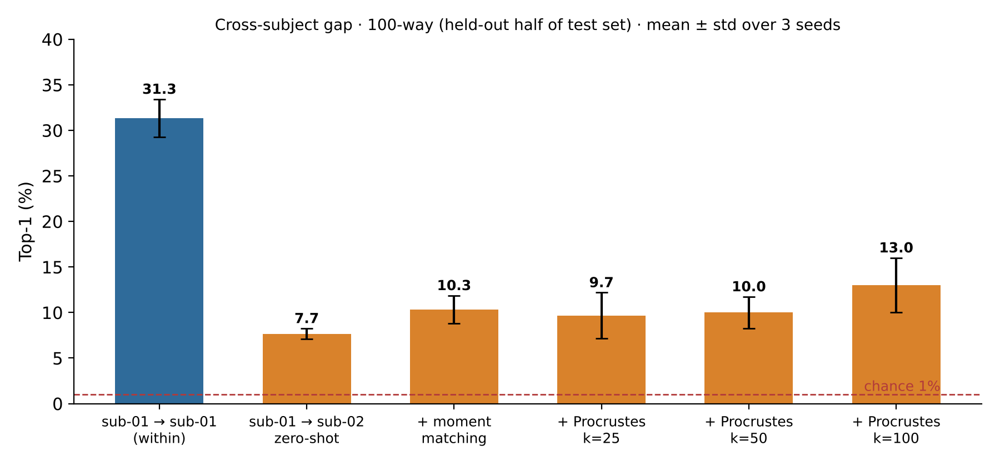
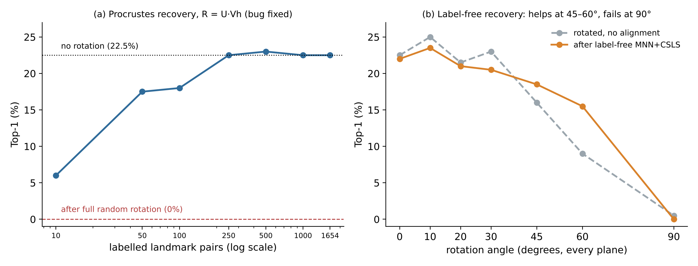
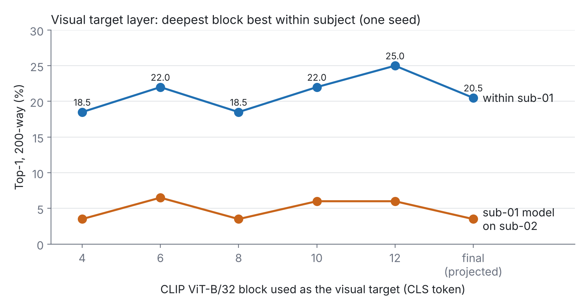
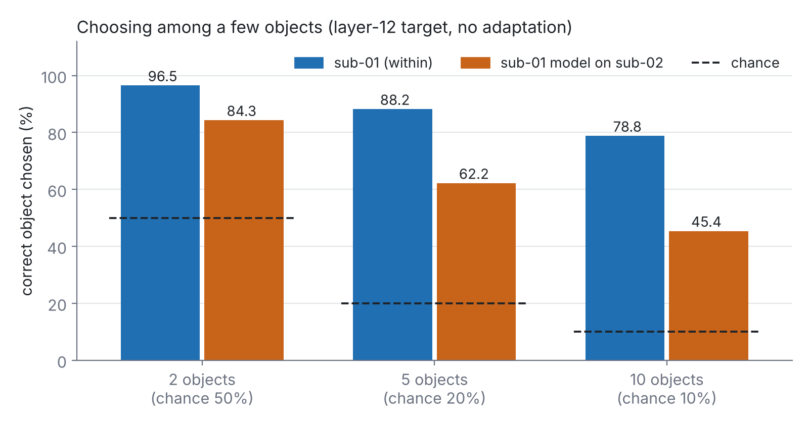

# EEG-Image Alignment: Phase 1 Baseline (THINGS-EEG2)

Preliminary PhD work (supervisors: Dr. Leila Safari, Dr. Mohsen Afsharchi).
Aim of this phase: a reproducible EEG-to-image zero-shot retrieval baseline, and a measurement of how well it transfers to new subjects. The image encoder is treated as a replaceable target, not a fixed design choice.

## Notebooks

| Notebook | Content |
|---|---|
| `01_baseline.ipynb` | Within-subject baseline, text regularizer, SCORE-style sanity check, sub-01 to sub-02 calibration, all 10 subjects, 10 x 10 cross-subject matrix |
| `02_loso.ipynb` | Leave-one-subject-out training (9 subjects) and Procrustes calibration on the held-out subject |
| `03_layer_ablation.ipynb` | Visual target taken from different CLIP blocks; within/cross-subject and k-way accuracy |

All notebooks run on a free Colab T4. Data: THINGS-EEG2 preprocessed 250 Hz release (Hugging Face `LidongYang/EEG_Image_decode`), not included here.

## Setup

| Item | Value |
|---|---|
| Data | THINGS-EEG2, 63 channels x 250 samples, repetitions averaged |
| Split | 16,540 training images (1,654 concepts); validation = 1 image per training concept; test = 200 unseen concepts |
| EEG encoder | temporal-spatial convolution (ShallowConvNet/NICE family) + projection |
| Target | frozen CLIP ViT-B/32 image features (text features optional) |
| Loss | symmetric InfoNCE with learnable temperature |
| Training | AdamW, lr 3e-4, batch 256, early stopping on validation Top-5 |

Chance: 200-way Top-1 0.5%, Top-5 2.5%; 100-way Top-1 1%.

## Results

### 1. Within-subject, sub-01, 3 seeds (`results/results_within_subject_run1.csv`)

| Variant | Top-1 (%) | Top-5 (%) |
|---|---|---|
| Previous prototype (2,000 samples, 1 conv layer, 5 epochs) | 0.0 | - |
| EEG to image | 22.7 ± 1.3 | 55.2 ± 2.5 |
| EEG to image + text (λ = 0.1) | 20.8 ± 0.8 | 53.8 ± 1.8 |

The class-name text regularizer gives no gain. A second run with the same seeds (`results_within_subject_run2.csv`) gave 22.8 ± 2.0 / 55.0 ± 3.5 and 21.2 ± 0.3 / 53.8 ± 1.6, the same conclusion.

### 2. All 10 subjects, seed 0 (`results/results_all_subjects.csv`)

Top-1 28.6 ± 6.6%, Top-5 62.5 ± 7.8% (range 15.0% for sub-05 to 39.0% for sub-08).

### 3. 10 x 10 cross-subject matrix, no adaptation (`results/results_cross_matrix.csv`)

Model trained on subject i, tested on subject j. Diagonal 27.2%, off-diagonal 4.5 ± 2.0%.

Here every test set is normalized with its own statistics (needed for unseen subjects), which is why the diagonal differs from section 2. Normalization alone moves sub-05 from 15.0% to 24.0%.

### 4. Leave-one-subject-out (`results/results_loso.csv`)

Trained on 9 subjects, tested on the held-out one (3 folds so far).

| Held-out subject | Top-1 (%) | Top-5 (%) |
|---|---|---|
| sub-01 | 10.0 | 31.0 |
| sub-05 | 10.5 | 31.5 |
| sub-08 | 13.0 | 35.0 |
| Mean | 11.2 | 32.5 |

Training on nine subjects raises transfer from 4.5% (one training subject) to 11.2%. On the 100-way evaluation half, Procrustes calibration with 25, 50 or 100 labelled trials of the new subject gives no clear gain after LOSO (17.7% before; 19.0%, 17.7% and 17.7% after), whereas it helped in the one-subject setting (section 5). A rotation alone is not enough once the model is trained on many subjects.

Reported values come from the cited papers and use larger encoders and visual targets; they are reference points, not a controlled comparison.

### 5. sub-01 to sub-02 calibration, 100-way (`results/results_cross_subject_sub01_sub02.csv`)

| Method | Top-1 (%) |
|---|---|
| within sub-01 | 31.3 |
| zero-shot on sub-02 | 7.7 |
| moment matching (label-free) | 10.3 |
| Procrustes, 100 labelled trials | 13.0 |

### 6. SCORE-style sanity check (`results/results_score.csv`)

- Procrustes fix: R = U @ Vh (the prototype used U @ Vh.T).
- Full random rotation: 22.5% to 0%; recovered to 17.5% with 50 labelled pairs and fully with 250.
- Label-free MNN + CSLS helps at moderate angles (60°: 9.0% to 15.5%) but fails at 90°.

### 7. Visual target layer, sub-01, seed 0 (`results/results_layers.csv`)

| Target | Within Top-1 | Within Top-5 | sub-01 model on sub-02, Top-1 |
|---|---|---|---|
| block 4 | 18.5 | 51.0 | 3.5 |
| block 6 | 22.0 | 59.0 | 6.5 |
| block 8 | 18.5 | 51.0 | 3.5 |
| block 10 | 22.0 | 54.0 | 6.0 |
| block 12 | 25.0 | 61.0 | 6.0 |
| final (projected) | 20.5 | 56.0 | 3.5 |

The last block before CLIP's image-text projection gives the best within-subject accuracy. Cross-subject differences are within noise (one image = 0.5%). One seed only; to be repeated.

### 8. Choosing among a few objects

Expected accuracy when the candidate set is the true image plus k-1 random others (computed exactly from retrieval ranks). Block-12 target:

| Candidates | Chance | Within sub-01 | sub-01 model on sub-02 |
|---|---|---|---|
| 2 | 50% | 96.5% | 84.3% |
| 5 | 20% | 88.2% | 62.2% |
| 10 | 10% | 78.8% | 45.4% |

## Limitations

- LOSO on 3 of 10 folds; layer ablation on one subject and one seed.
- 100-way calibration numbers use 100 test images (one image = 1%).
- Text uses class-name prompts only.

## Next steps

1. LOSO on all 10 folds, and k-way accuracy for LOSO models.
2. Richer per-subject calibration (subject-specific linear layer or normalization) instead of a rotation.
3. Repeat the layer ablation with 3 seeds and more subjects.
4. Rich image captions as text targets.
