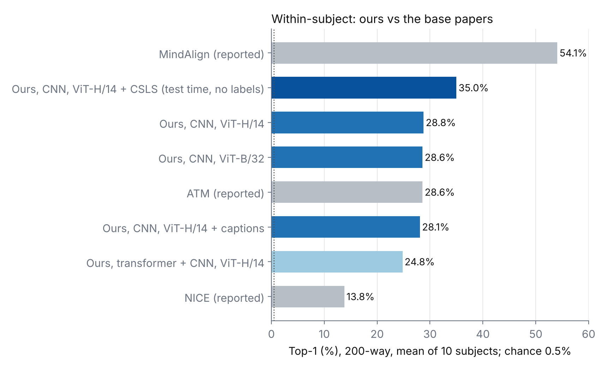
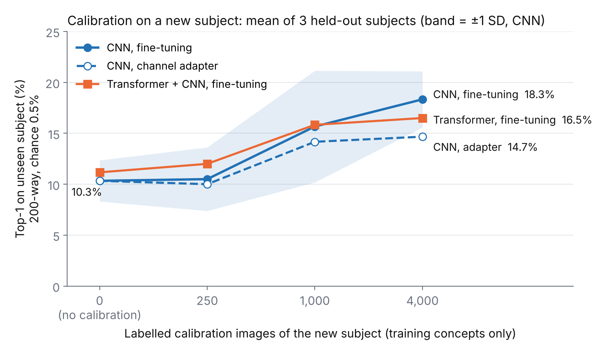
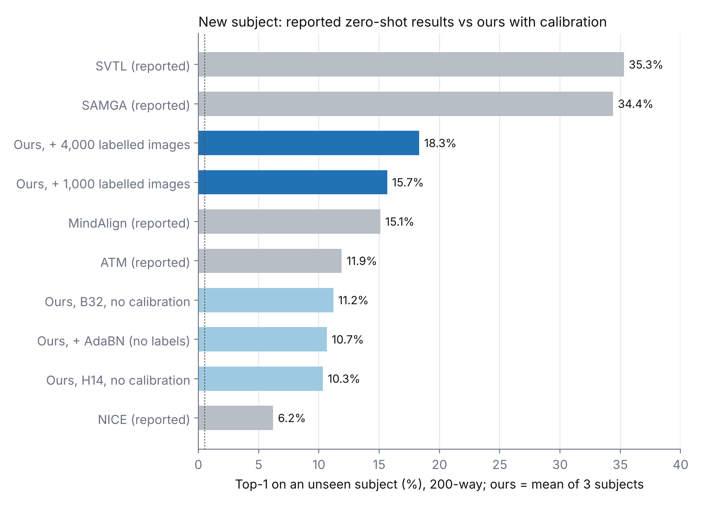
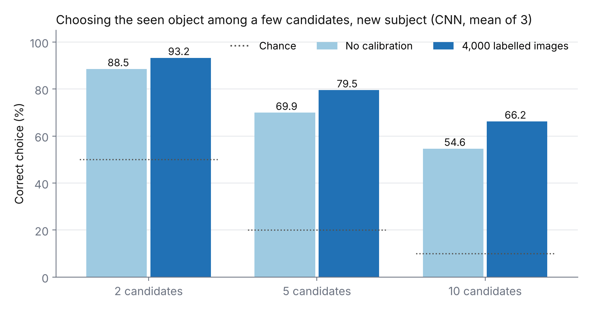
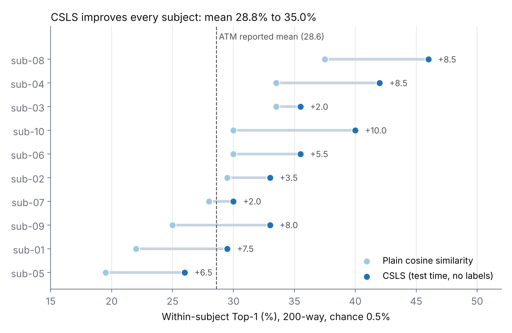
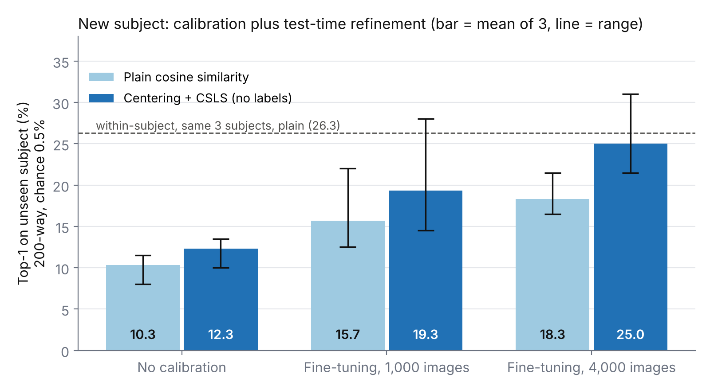
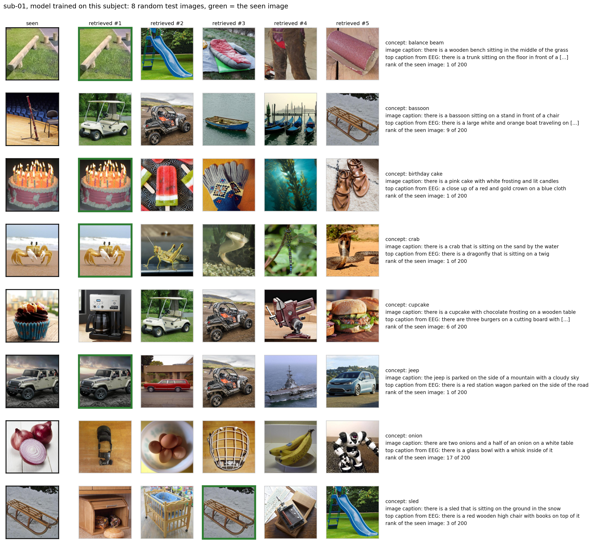
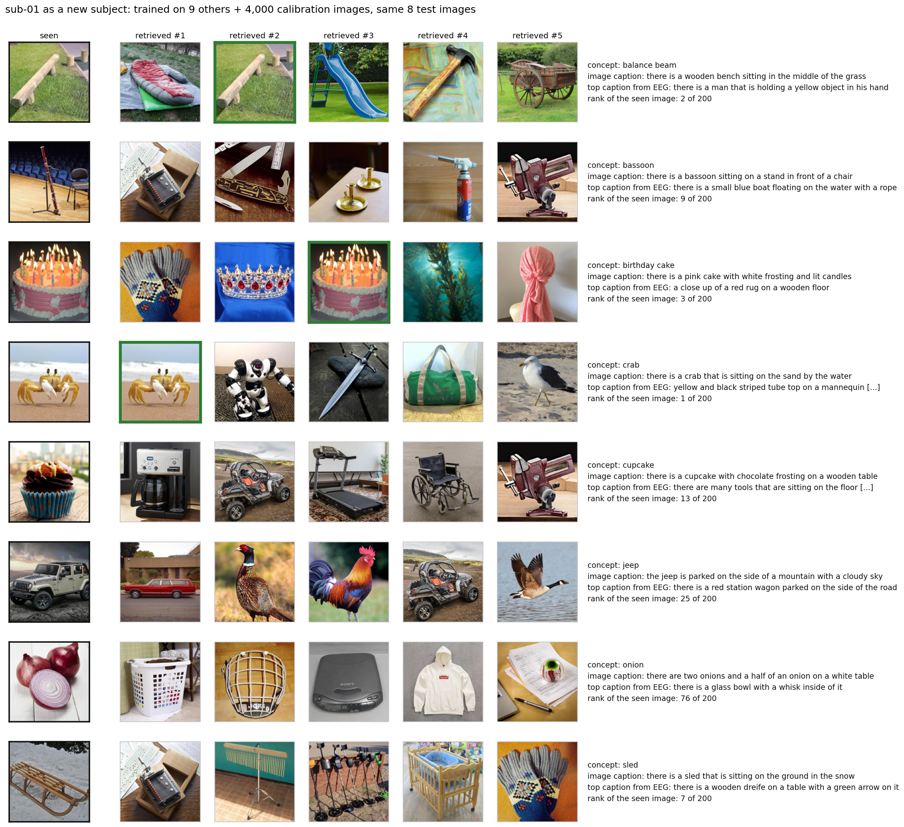

# EEG–Image–Text Alignment on THINGS-EEG2: Phase 1

Preliminary PhD work. Supervisors: Dr. Leila Safari, Dr. Mohsen Afsharchi.

Aim of this phase: a reproducible zero-shot retrieval baseline that aligns EEG with images and text, and a measurement of how well it transfers to a new subject. The image and text encoders are treated as replaceable targets, not as a fixed design choice.

## Updates

| Date | Added |
|---|---|
| 2026-10-27 | `04_trimodal_crosssubject.ipynb`: ViT-H/14 target, caption alignment, CNN vs transformer, LOSO with calibration, test-time refinement with CSLS, single-trial training, qualitative examples; results sections 9–14; figures 9–16 |
| 2026-10-26 | `01_baseline.ipynb`, `02_loso.ipynb`, `03_layer_ablation.ipynb`; results sections 1–8; figures 1–8 |

## Notebooks

| Notebook | Content |
|---|---|
| `01_baseline.ipynb` | Within-subject baseline, text regularizer, SCORE-style sanity check, sub-01 to sub-02 calibration, all 10 subjects, 10 x 10 cross-subject matrix |
| `02_loso.ipynb` | Leave-one-subject-out training on 9 subjects and Procrustes calibration on the held-out subject |
| `03_layer_ablation.ipynb` | Visual target taken from different CLIP blocks; within-subject, cross-subject and k-way accuracy |
| `04_trimodal_crosssubject.ipynb` | CLIP ViT-H/14 target, BLIP captions as a third modality, CNN vs transformer + CNN encoder, leave-one-subject-out with calibration, test-time refinement |

Notebooks 01–03 run on a free Colab T4; notebook 04 was run on a Colab L4. Data: the THINGS-EEG2 preprocessed 250 Hz release on Hugging Face, `LidongYang/EEG_Image_decode`, not included here.

## Data

| Item | Value |
|---|---|
| Dataset | THINGS-EEG2, Gifford et al., NeuroImage 2022: [OSF](https://osf.io/3jk45/) |
| Preprocessed release used | [Hugging Face, LidongYang/EEG_Image_decode](https://huggingface.co/datasets/LidongYang/EEG_Image_decode), released with ATM |
| Subjects | 10 |
| Input per trial | 63 channels x 250 samples = 0–1 s at 250 Hz |
| Training set | 16,540 images from 1,654 concepts, 10 images per concept, 4 repetitions each |
| Validation | 1 image per training concept = 1,654 images, held out from training |
| Test set | 200 concepts never seen in training, 1 image each, 80 repetitions averaged |
| Normalization | channel z-score; notebooks 01–03 use training statistics, notebook 04 each recording's own statistics |

Chance: 200-way Top-1 0.5%, Top-5 2.5%; 100-way Top-1 1%.

## Training configuration of each experiment

| Experiment | Notebook | Encoder, parameters | Target | Subjects or folds | Training trials | Max epochs, patience | Batch | Seeds | GPU, time |
|---|---|---|---|---|---|---|---|---|---|
| Within-subject | 01 | CNN, 1.10 M | ViT-B/32 | sub-01 x 3 seeds; 10 subjects x 1 seed | 14,886 | 40, 10 | 256 | 0, 1, 2; then 0 | T4, ~4 min per subject |
| LOSO | 02 | CNN, 1.10 M | ViT-B/32 | 3 folds | ~134,000 | 20, 5 | 256 | 0 | T4 |
| Layer ablation | 03 | CNN, 1.10 M | ViT-B/32 blocks 4–12 | sub-01 | 14,886 | 40, 10 | 256 | 0 | T4 |
| Within-subject | 04 | CNN, 2.63 M | ViT-H/14 | 10 subjects | 14,886 | 40, 10 | 256 | 0 | L4, ~1.7 min |
| Within-subject, captions | 04 | CNN, 2.63 M | ViT-H/14 + caption | 10 subjects | 14,886 | 40, 10 | 256 | 0 | L4, ~1.5 min |
| Within-subject | 04 | Transformer + CNN, 3.07 M | ViT-H/14 | 10 subjects | 14,886 | 40, 10 | 256 | 0 | L4, ~3 min |
| LOSO + calibration | 04 | CNN; Transformer + CNN | ViT-H/14 | 3 folds | ~134,000 | 20, 5 | 256 | 0 | L4, ~9 / ~18 min per fold |
| Single trials | 04 | CNN, 2.63 M | ViT-H/14 | sub-01, sub-05, sub-08 | 59,544 | 40, 10 | 1024 | 0 | L4, ~7.4 min |

Shared hyperparameters:

| Hyperparameter | Value |
|---|---|
| Optimizer | AdamW, lr 3e-4, weight decay 1e-4 |
| Loss | symmetric InfoNCE, learnable temperature starting at 0.07 |
| Dropout | 0.5 |
| Text weight λ | 0.1 |
| Calibration, adapter | 63 x 63 channel mixing, identity start, base frozen, 300 steps, lr 1e-3 |
| Calibration, fine-tuning | all weights, 300 steps, lr 1e-4 |
| Calibration images k | 250, 1,000, 4,000; training concepts only |
| CSLS | 10 nearest EEG embeddings from unlabeled training-session EEG |
| Determinism | fixed seed, cuDNN deterministic; reruns match exactly |

## Base papers and what was taken from each

| Paper | Link | Used in notebooks | What was taken |
|---|---|---|---|
| NICE, Song et al., ICLR 2024 | [arXiv 2308.13234](https://arxiv.org/abs/2308.13234) | all four: 01, 02, 03, 04 | temporal-spatial CNN encoder; contrastive EEG–image alignment; 200-way zero-shot protocol |
| ATM, Li et al., NeurIPS 2024 | [arXiv 2403.07721](https://arxiv.org/abs/2403.07721) | all four: 01, 02, 03, 04 | preprocessed THINGS-EEG2 release; ViT-H/14 target in 04; channel-attention layer before the CNN in 04, ATM-style rather than a reproduction |
| THINGS-EEG2, Gifford et al., NeuroImage 2022 | [doi](https://doi.org/10.1016/j.neuroimage.2022.119754) | all four: 01, 02, 03, 04 | dataset |
| CLIP, Radford et al., ICML 2021 | [arXiv 2103.00020](https://arxiv.org/abs/2103.00020) | 01, 02, 03 | ViT-B/32 image and text features |
| OpenCLIP, Cherti et al., CVPR 2023 | [arXiv 2212.07143](https://arxiv.org/abs/2212.07143) | 04 | ViT-H/14, `laion2b_s32b_b79k` |
| BLIP, Li et al., ICML 2022 | [arXiv 2201.12086](https://arxiv.org/abs/2201.12086) | 04 | one caption per image, `blip-image-captioning-large` |
| MindAlign, 2026 | [arXiv 2605.24523](https://arxiv.org/html/2605.24523v1) | 01, 04 | text as an auxiliary contrastive term, weight 0.1 |
| ENIGMA, 2026 | [arXiv 2602.10361](https://arxiv.org/html/2602.10361) | 04 | small subject-specific layer trained on a short calibration set |
| AdaBN, Li et al. | [arXiv 1603.04779](https://arxiv.org/abs/1603.04779) | 04 | BatchNorm statistics re-estimated on the new subject without labels |
| CSLS, Conneau et al., ICLR 2018 | [arXiv 1710.04087](https://arxiv.org/abs/1710.04087) | 01, 04 | hubness-corrected similarity at test time |

## Settings compared with the base papers

| | NICE 2024 | ATM 2024 | Ours, notebooks 01–03 | Ours, notebook 04 |
|---|---|---|---|---|
| EEG encoder | TSConv | MLP + TSConv + channel attention | TSConv + projection | TSConv + projection; transformer layer + TSConv |
| Parameters | 102 k, encoder only | 3.18 M | 1.10 M | 2.63 M; 3.07 M |
| Visual target | CLIP ViT-L/14 | CLIP, 1024-d | CLIP ViT-B/32, 512-d | OpenCLIP ViT-H/14, 1024-d |
| Text | – | – | class-name prompt | BLIP caption |
| Training trials per subject | 16,540 averaged | 66,160 single trials | 16,540 averaged | 16,540 averaged |
| Optimizer, lr | Adam, 2e-4 | Adam, 3e-4 | AdamW, 3e-4, wd 1e-4 | AdamW, 3e-4, wd 1e-4 |
| Batch | 1000 | 1024 | 256 | 256 |
| Epochs | 200 | not stated | ≤ 40 with early stopping on validation Top-5; LOSO ≤ 20 | same |
| Precision, GPU | – | – | fp32, T4 | bf16, L4 |
| Within Top-1 % | 13.8 | 28.6 | 28.6 | 28.8; 35.0 with CSLS |
| LOSO Top-1 % | 6.2 | 11.9 | 11.2 | 10.3; 25.0 with 4,000 calibration images + refinement |

Base-paper values are as reported in the papers.

## Summary: notebooks 01–03 vs notebook 04

| Question | Ours, notebooks 01–03 | Ours, notebook 04 |
|---|---|---|
| Within-subject Top-1 | 27.2 with own-statistics normalization | 28.8 |
| EEG to text retrieval | class-name text, no gain | EEG to caption Top-1 15.4%, chance 0.5% |
| New subject, no calibration | 11.2 | 10.3 |
| New subject, calibrated | Procrustes, no clear gain | 18.3 with fine-tuning on 4,000 images; 25.0 with refinement |
| Test-time refinement | MNN + CSLS in the rotation test only | CSLS: within 28.8 to 35.0, all 10 subjects improve |
| More complex encoder | – | transformer layer: lower within-subject accuracy, 24.8, and unstable calibration |

## Results

### 1. Within-subject, sub-01, 3 seeds

File: `results/results_within_subject_run1.csv`

| Variant | Top-1 % | Top-5 % |
|---|---|---|
| Previous prototype: 2,000 samples, 1 conv layer, 5 epochs | 0.0 | – |
| EEG to image | 22.7 ± 1.3 | 55.2 ± 2.5 |
| EEG to image + text, λ = 0.1 | 20.8 ± 0.8 | 53.8 ± 1.8 |

The class-name text regularizer gives no gain. A second run with the same seeds, `results_within_subject_run2.csv`, gave 22.8 ± 2.0 / 55.0 ± 3.5 and 21.2 ± 0.3 / 53.8 ± 1.6, the same conclusion.

### 2. All 10 subjects, seed 0

File: `results/results_all_subjects.csv`

Top-1 28.6 ± 6.6%, Top-5 62.5 ± 7.8%. Range: 15.0% for sub-05 to 39.0% for sub-08.

### 3. 10 x 10 cross-subject matrix, no adaptation

File: `results/results_cross_matrix.csv`

Model trained on subject i, tested on subject j. Diagonal 27.2%, off-diagonal 4.5 ± 2.0%.

Here every test set is normalized with its own statistics, as needed for unseen subjects, which is why the diagonal differs from section 2. Normalization alone moves sub-05 from 15.0% to 24.0%.

### 4. Leave-one-subject-out

File: `results/results_loso.csv`

Trained on 9 subjects, tested on the held-out one; 3 folds so far.

| Held-out subject | Top-1 % | Top-5 % |
|---|---|---|
| sub-01 | 10.0 | 31.0 |
| sub-05 | 10.5 | 31.5 |
| sub-08 | 13.0 | 35.0 |
| Mean | 11.2 | 32.5 |

Training on nine subjects raises transfer from 4.5% with one training subject to 11.2%. On the 100-way evaluation half, Procrustes calibration with 25, 50 or 100 labeled trials of the new subject gives no clear gain after LOSO: 17.7% before; 19.0%, 17.7% and 17.7% after. It helped in the one-subject setting of section 5. A rotation alone is not enough once the model is trained on many subjects.

Reported values come from the cited papers and use larger encoders and visual targets; they are reference points, not a controlled comparison.

### 5. sub-01 to sub-02 calibration, 100-way

File: `results/results_cross_subject_sub01_sub02.csv`

| Method | Top-1 % |
|---|---|
| within sub-01 | 31.3 |
| zero-shot on sub-02 | 7.7 |
| moment matching, label-free | 10.3 |
| Procrustes, 100 labeled trials | 13.0 |

### 6. SCORE-style sanity check

File: `results/results_score.csv`

- Procrustes fix: R = U @ Vh; the prototype used U @ Vh.T.
- Full random rotation: 22.5% to 0%; recovered to 17.5% with 50 labeled pairs and fully with 250.
- Label-free MNN + CSLS helps at moderate angles, 60°: 9.0% to 15.5%, but fails at 90°.

### 7. Visual target layer, sub-01, seed 0

File: `results/results_layers.csv`

| Target | Within Top-1 | Within Top-5 | sub-01 model on sub-02, Top-1 |
|---|---|---|---|
| block 4 | 18.5 | 51.0 | 3.5 |
| block 6 | 22.0 | 59.0 | 6.5 |
| block 8 | 18.5 | 51.0 | 3.5 |
| block 10 | 22.0 | 54.0 | 6.0 |
| block 12 | 25.0 | 61.0 | 6.0 |
| final projected | 20.5 | 56.0 | 3.5 |

The last block before CLIP's image-text projection gives the best within-subject accuracy. Cross-subject differences are within noise; one image = 0.5%. One seed only; to be repeated.

### 8. Choosing among a few objects

Expected accuracy when the candidate set is the true image plus k-1 random others, computed exactly from retrieval ranks. Block-12 target:

| Candidates | Chance | Within sub-01 | sub-01 model on sub-02 |
|---|---|---|---|
| 2 | 50% | 96.5% | 84.3% |
| 5 | 20% | 88.2% | 62.2% |
| 10 | 10% | 78.8% | 45.4% |

## Notebook 04: stronger target, tri-modal alignment, calibration, test-time refinement

Changes from notebooks 01–03:

- visual target CLIP ViT-H/14, LAION-2B, 1024-d;
- one BLIP-large caption per image, encoded with the CLIP text encoder;
- two EEG encoders: the same CNN with 2.63 M parameters, and an ATM-style channel-attention transformer layer in front of it with 3.07 M parameters;
- channel z-score with each recording's own statistics;
- bf16 mixed precision.

### 9. Within-subject, 10 subjects

File: `results/results_within_v2.csv`

| Encoder | Target | Text | Top-1 % | Top-5 % | EEG to caption Top-1 % | EEG to class name Top-1 % |
|---|---|---|---|---|---|---|
| CNN | ViT-H/14 | none | 28.8 ± 5.5 | 61.0 | 14.1 ± 3.0 | 10.4 |
| CNN | ViT-H/14 | caption, λ = 0.1 | 28.1 ± 5.3 | 60.7 | 15.4 ± 2.8 | 11.9 |
| transformer + CNN | ViT-H/14 | none | 24.8 ± 8.1 | 55.5 | 12.4 ± 3.9 | 11.6 |

Mean ± SD over 10 subjects, 200-way, chance 0.5%. The same EEG embedding retrieves the seen image and its caption. Training with captions raises EEG-to-caption retrieval from 14.1 to 15.4 at a small cost in image retrieval, 28.8 to 28.1. The transformer layer lowers accuracy and increases spread across subjects at this data size.

### 10. Leave-one-subject-out with calibration

File: `results/results_loso_v2.csv`

Trained on 9 subjects. The held-out subject is calibrated with k of its own training-session images; these are training concepts only, and the 200 test concepts stay unseen. AdaBN uses the same subject's unlabeled EEG.

| Method, CNN | k | Top-1 % | 5-way % |
|---|---|---|---|
| none | 0 | 10.3 ± 2.0 | 69.9 |
| AdaBN, no labels | 0 | 10.7 ± 2.0 | 70.0 |
| channel adapter, 63 x 63 | 4,000 | 14.7 ± 1.9 | 77.8 |
| fine-tuning | 1,000 | 15.7 ± 5.5 | 76.7 |
| fine-tuning | 4,000 | 18.3 ± 2.8 | 79.5 |

Mean ± SD over sub-01, sub-05, sub-08. Fine-tuning with 4,000 images raises Top-1 in every held-out subject: 11.5 to 16.5, 8.0 to 17.0, 11.5 to 21.5. The transformer + CNN encoder reaches 16.5 ± 9.6 with the same calibration, with a much larger spread across subjects. Label-free AdaBN alone gives no clear gain.

Reported values are zero-shot results from the cited papers with different encoders and training data; they are reference points, not a controlled comparison.

### 11. Choosing among a few objects, new subject

On a new subject, choosing the seen object among 5 candidates rises from 69.9% without calibration to 79.5% with fine-tuning on 4,000 images and 84.4% with CSLS added; chance is 20%.

### 12. Test-time refinement without labels

Files: `results/results_refine.csv` for the new-subject runs and sub-01, sub-05, sub-08 within-subject; `results/results_refine_within_all.csv` for Top-1 of all 10 subjects within-subject

The trained encoder is unchanged. Two corrections of the similarity scores are computed only from the subject's unlabeled training-session EEG; no test labels and no test EEG beyond the query itself are used.

- Centering: subtract the subject's mean EEG embedding and the mean training-image embedding, then re-normalize.
- CSLS, Conneau et al., ICLR 2018: the score of image y is 2 × its cosine similarity to the query minus its hub score, where the hub score is the mean similarity of y to its 10 nearest EEG embeddings of that subject. This penalizes "hub" images that are close to many EEG embeddings.

| Setting | Plain | Centering | CSLS | Centering + CSLS |
|---|---|---|---|---|
| Within-subject, 10 subjects | 28.8 ± 5.5 | 29.7 ± 6.0 | 35.0 ± 6.1 | 35.4 ± 6.6 |
| New subject, no calibration, 3 subjects | 10.3 | 10.5 | 11.7 | 12.3 |
| New subject, fine-tuning on 1,000 images, 3 subjects | 15.7 | 15.2 | 19.2 | 19.3 |
| New subject, fine-tuning on 4,000 images, 3 subjects | 18.3 | 17.3 | 23.3 | 25.0 |

Top-1 %, 200-way. CSLS improves every one of the 10 subjects within-subject, by +2.0 to +10.0. On a new subject it helps most after calibration: with 4,000 calibration images the new-subject accuracy of 25.0 approaches the within-subject accuracy of the same three subjects without refinement, 26.3. The plain column repeats the earlier runs exactly with the same seeds.

### 13. ATM training recipe: single trials and batch 1024

File: `results/results_single_trials.csv`

ATM trains on all single trials, 66,160 per subject, with batch 1024; notebooks 01–04 use the average of the 4 repetitions, 16,540, and batch 256. Single trials are scaled with the statistics of the averaged training data so that they match the test scale.

| sub-01 / 05 / 08, Top-1 % | Plain | CSLS | Centering + CSLS |
|---|---|---|---|
| averaged repetitions, batch 256 | 26.3 | 33.8 | 35.0 |
| single trials, batch 1024 | 27.0 | 35.8 | 36.8 |

Four times more training samples and a four times larger batch change accuracy by less than one image in 200 without refinement, and by about 2 points with CSLS. The training recipe is not what separates this baseline from ATM; the test-time correction is the larger effect.

### 14. Qualitative examples, sub-01

File: `results/results_examples_sub01.csv`

Eight test images drawn at random with a fixed seed, not selected by hand. Each row shows the image the subject saw, the five images retrieved from that EEG trial among 200, and the caption retrieved from the same EEG embedding; scores use CSLS. The same eight images are shown for the model trained on sub-01 and for sub-01 treated as a new subject.

| | Seen image ranked first | Seen image in top 5 |
|---|---|---|
| Model trained on sub-01 | 4 of 8 | 5 of 8 |
| sub-01 as a new subject, 4,000 calibration images | 1 of 8 | 3 of 8 |

Errors are mostly semantically or visually close to the seen image: jeep → station wagon, buggy, minivan; crab → grasshopper, eel, dragonfly; birthday cake → popsicle; sled → crib. Top-1 over all 200 test images for these two models is 29.5% and 22.5%.

## Limitations

- LOSO on 3 of 10 folds and one seed; layer ablation on one subject and one seed.
- 100-way calibration numbers use 100 test images; one image = 1%.
- Calibration still needs 1,000–4,000 labeled images to help; 250 gives no gain.
- Test-time refinement uses the subject's unlabeled training-session EEG, so it needs a short unlabeled recording of the new subject.

## Next steps

1. LOSO on all 10 folds with 3 seeds.
2. Calibration with fewer labeled images: label-free test-time refinement, subject layers trained jointly with the shared encoder.
3. Posterior channel selection and a blurred visual target, the main gains reported by UBP, CVPR 2025.
4. Fixation-locked EEG with eye tracking, Phase 2.

## Other papers cited

- [UBP, Wu et al., CVPR 2025](https://arxiv.org/abs/2503.04207)
- [SVTL, 2026](https://arxiv.org/html/2609.36971)
- [SAMGA, 2026](https://arxiv.org/html/2604.17782)
- [SATTC, CVPR 2026](https://arxiv.org/abs/2603.20738)
